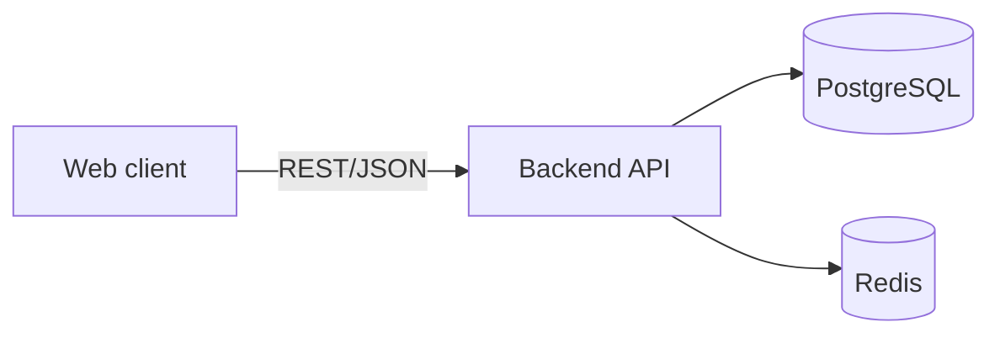

# Architecture

> Status: living document. This reflects the intended architecture of the
> platform; parts marked as planned are not implemented yet.

## Overview

head-recruiter is a platform for head recruiting. It is organized as a set of
independently deployable components within a single repository:

## Components

### Backend (`backend/`)

A Spring Boot application exposing a REST API.

- **Web layer:** Spring Web MVC (controllers, DTOs, validation).
- **Domain/service layer:** business logic.
- **Persistence layer:** Spring Data JPA over PostgreSQL.
- **Migrations:** Liquibase.
- **Cache / sessions:** Redis.
- **Security:** Spring Security.

### Frontend (`frontend/`) — planned

The web client that consumes the backend API.

### Infrastructure (`infra/`)

Local development environment (Docker Compose: PostgreSQL, Redis) and, in time,
deployment configuration.

## Cross-cutting concerns

- Configuration via environment variables; secrets are never committed.
- Database schema changes are versioned with Liquibase.
- Continuous integration runs the backend build and tests.

## Related decisions

See the [Architecture Decision Records](adr/).
